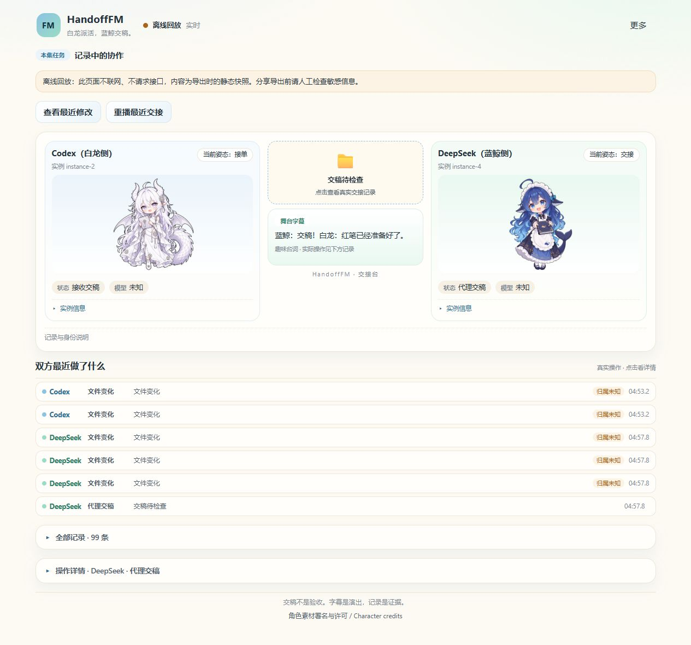

# HandoffFM

[](https://github.com/Alexstrasza231/handoff-fm/actions/workflows/ci.yml)

**See which AI ran which tool, what changed, and what still needs checking.**

HandoffFM turns a local Codex ↔ DeepSeek collaboration into a whale-and-dragon stage. Open the
handoff, inspect recorded changes, and replay the work without running it again. Records stay local;
you choose what to include in an offline share.

### A real problem, fixed by the two agents

**“I refreshed, and my active collaboration disappeared.”** DeepSeek fixed backend run ordering;
Codex added tab-local selection retention and checked both changes. The case includes the root
cause, the failing regressions, and commands to verify it yourself.

[Read the real debugging case](./docs/cases/refresh-selection.md) · [中文案例](./docs/cases/refresh-selection.zh-CN.md) · [Reviewed, content-free event sequence](./docs/cases/refresh-events.json)

<a href="docs/cases/refresh-selection.md"></a>

This screenshot uses actual records from that delegation, with prompts, paths, differences and
outputs excluded and identities aliased. It is a real offline projection, not the sample scenario.

<details><summary>Earlier real component-edit recording (v0.1.0 interface)</summary>

<a href="docs/media/real-handoff.webm"></a>

[Watch the real recording](./docs/media/real-handoff.webm) · [Reviewed event export](./docs/media/real-events.json)

The recording follows a real Codex → DeepSeek → Codex component edit. Replay selection skips
waiting time; timestamps and evidence labels are preserved. Both file changes remain `unknown`
attribution, and the corrected verification result is an agent declaration. [Recording details](./docs/media/README.md).

</details>

[中文说明](./README.zh-CN.md) · [Usage](./docs/usage.md) · [Evidence model](./docs/evidence.md)

- **Observed, declared, unknown — never blurred.** Every record carries an `actor` and an
  `evidence` level, and an export never upgrades one.
- **Nothing is uploaded.** Records live in `<project>/.handoff-fm/`, the viewer binds
  `127.0.0.1` only, and exports are self-contained files that make no network requests.
- **Share the shape, not the content.** The default export has no prompts, paths, diffs, or
  outputs. Each category is a separate opt-in, previewed first.

## Quickstart (installed release)

Requires **Node.js 22.12+** and a Codex build with plugins and hooks. Installing the plus-level
DeepSeek CLI (`dsh`) and authenticating it is a prerequisite for `delegate` only; HandoffFM never
reads or stores your credentials. The CLI, logs and export metadata are English; the viewer UI and
its stage captions are Chinese.

```sh
# 1. install the CLI (self-contained bundle, no build step)
npm install -g https://github.com/Alexstrasza231/handoff-fm/releases/download/v0.1.1/handoff-fm-0.1.1.tgz

# 2. enable one project, then check the environment
cd /path/to/your/project
handoff-fm init
handoff-fm doctor

# 3. install the plugin, trust its exact six hooks in Codex, then start watching
codex plugin marketplace add https://github.com/Alexstrasza231/handoff-fm
codex plugin add handoff-fm@handoff-fm
#    open /hooks in Codex and approve the exact six HandoffFM hook definitions
handoff-fm watch
```

`watch` prints a one-time loopback URL with an access token:

```
HandoffFM watching enabled project
http://127.0.0.1:4417/#token=<hex>
Keep this process running. The URL grants access to local records; do not share it.
```

`init` writes the project config, adds `.handoff-fm/` to `.gitignore`, and registers the project
locally. It never overwrites an existing config; flags such as `--dsh-command PATH` explicitly
extend it (use this when `dsh` is not on `PATH`). Only new recorded activity can be replayed.

## Handing one task over

`delegate` runs a bounded task through `dsh headless --json -`, records the normalized event
stream under the **real** parent Codex session ID, passes DeepSeek's final answer to stdout, and
prints the run ID to stderr. It grants no new permission: keep your existing tool and scope
restrictions in place before running it.

````sh
cat > .handoff-fm/task.md <<'EOF'
Summarize the failing test and propose the smallest fix. Do not commit.
EOF

handoff-fm delegate deepseek \
  --task-file .handoff-fm/task.md \
  --title "Fix store test" \
  --parent-session <ACTUAL_CODEX_SESSION_ID> \
  --project /path/to/your/project
````

A green exit means the handoff is **submitted for review** (交稿待检查), not accepted. Inspect the
changed files and run your own checks. Exit code 0 only says *that command* passed.

## The viewer

- **Live** — new records stream in over SSE while you work.
- **Replay** — scrub or play at 1×/2×/4×, jump to the next handoff or failure.
- **Evidence panel** — per-record actor, kind, evidence level, tool identity, and reason string.
- **Demo** — a fully offline sample run, useful before you have any records.
- **Share preview** — pick categories, preview the exact reduced content, then download.

Stage captions are deterministic humor written for HandoffFM; they are not agent statements.

## What the records can and cannot prove

| Writer | Status |
| --- | --- |
| Codex isolated direct `apply_patch` | `observed` when the path is named in the patch, no sibling operation overlaps, and the before/after snapshots show exactly that change |
| Codex shell/script/overlapping edits | `unknown` — the writer is not established |
| DeepSeek file changes | **always** `unknown` candidate evidence: DSH stdout is asynchronous and is not a pre-write barrier |
| Agent final text | `declared` — the agent's own account, not a checked fact |

Consequently: DeepSeek file diffs are candidates, never proof. See
[evidence.md](./docs/evidence.md) for the full vocabulary and the verification status.

## Privacy

Default exports carry roles, generic event kinds, evidence levels, aliased IDs and relative
timing only. Prompts, paths, diffs and outputs are independent opt-ins, and the preview is written
first so you review the exact bytes before confirming. Masking (bearer tokens, `sk-`/`ghp_`
style keys, secret-named fields) is best effort only — review the preview yourself. Offline
exports are self-contained: inline bundle, `default-src 'none'`, no network fetch.

## Verified today, and what is not

- Exercised end-to-end on **Windows** with local Codex desktop and the real DSH wrapper; Windows
  Codex desktop `apply_patch` hooks have produced actual records after official CLI trust, and real
  DSH wrapper delegations are recorded.
- Windows and Linux CI exercise CLI, browser and packaged-install fixture tests.
  **No Linux/macOS desktop validation is claimed**; Linux Codex and DSH desktop runs remain untested.
- Desktop chat capture is not complete and nested-tool capture is not orchestrated: hooks record
  what the client actually delivers. Treat `codexHooks: observed` as "records are arriving for this
  project", not as proof of completeness.
- Not yet published to a package registry: the commands above target the GitHub **v0.1.1** release
  artifact. There is no npm registry install path.

## Development

```sh
npm ci
npm run build     # tsup -> dist/cli.js, vite -> web-dist/
npm test          # node --test via tsx over tests/
npm run check     # typecheck + unit tests + build
npm run test:browser   # Playwright acceptance tests against a real loopback server
```

`dist/` and `web-dist/` are tracked in this repository so the packaged plugin and the GitHub
release tarball work without dev dependencies. Rebuild before using any locally modified source.

## Licensing and credits

Related projects: [Handoff](https://github.com/open-grove/handoff) creates portable session context,
and [AgentDiff](https://github.com/natiixnt/AgentDiff) focuses on reviewing agent-produced code changes.
HandoffFM focuses on the local Codex + DeepSeek event stream, a character stage and selective offline
replay. These are references, not bundled dependencies; no global-first claim is made.

- **Code: MIT** (see [LICENSE](./LICENSE)).
- **Character artwork is not MIT and is not original CC BY.** Attribution and noncommercial terms
  apply. [LICENSE-ASSETS](./LICENSE-ASSETS) is authoritative per asset:
  - DeepSeek whale maid — original whale by **上善 / 上善无形**, DeepSeek maid adaptation by
    **ZipZipPipe**; the source identifies this whale adaptation as **CC BY-NC-SA 4.0**.
    HandoffFM's chibi proportions, props and pose variants were adapted by Alexstrasza231 using
    OpenAI image generation (October 2026).
  - White dragon — community GPT dragon design by **ZipZipPipe**, adapted for HandoffFM by
    Alexstrasza231 using OpenAI image generation, under the source author's
    attribution-required, noncommercial-use permission. No separate CC license or MIT grant is
    claimed for it.
  - The sprites are display skins for "which side is which"; they are not claims about model
    identity, and the UI shows `unknown` when tool/model metadata is unavailable.
- Reference inspiration: [Bilibili BV1EvKK6NEoi](https://www.bilibili.com/video/BV1EvKK6NEoi/) and
  [Pixiv artwork 148186519](https://www.pixiv.net/artworks/148186519). Video frames, soundtracks
  and third-party recordings are not distributed here.

The repository includes an actual browser recording of the real Windows collaboration, alongside
a clearly labelled sample replay available in the viewer.

## Documentation

| Document | Contents |
| --- | --- |
| [docs/usage.md](./docs/usage.md) | Requirements, CLI reference, plugin/hook trust, watch, delegate, export, troubleshooting |
| [docs/evidence.md](./docs/evidence.md) | Evidence vocabulary, attribution rules, privacy posture, verification status |
| [README.zh-CN.md](./README.zh-CN.md) | 中文说明 |
| [skills/handoff-fm/SKILL.md](./skills/handoff-fm/SKILL.md) | Packaged Codex skill that drives this workflow |

HandoffFM observes work you already authorized. It does not authorize delegation, does not execute
commands from the viewer, and does not modify your records.
