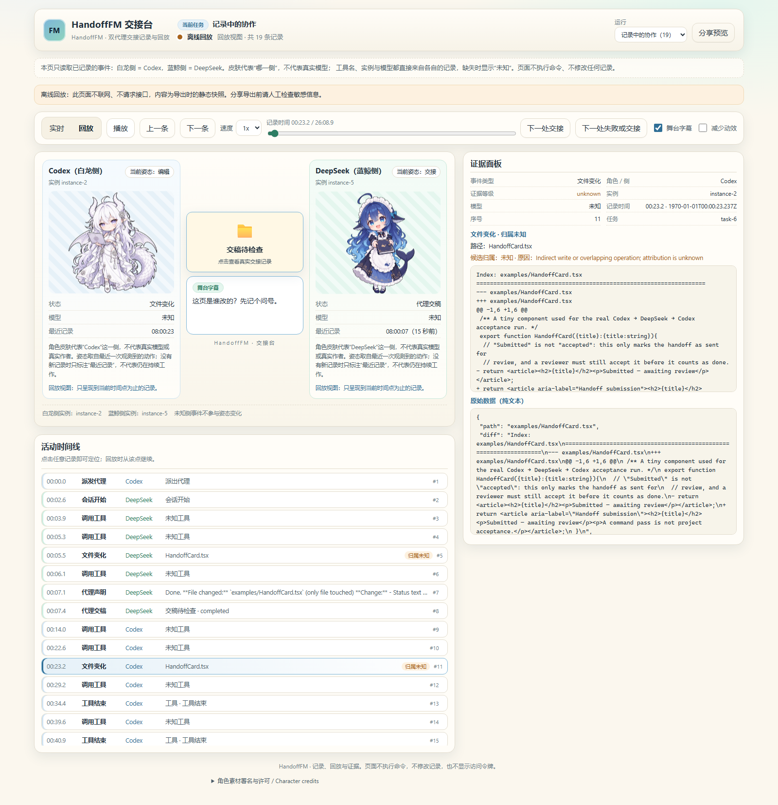

# HandoffFM 交接台

**给 Codex + DeepSeek 交接准备的本地、可回放直播台。**

HandoffFM 在单个本地项目里观察一次**你已经授权**的 Codex ↔ DeepSeek 协作，把每条记录的
证据等级原样保留，用白龙与蓝鲸的舞台形式回放，并只把你显式选中的内容导出成离线只读副本。

<a href="docs/media/real-handoff.webm"></a>

[观看真实录屏](./docs/media/real-handoff.webm) · [查看对应事件与代码差异](./docs/media/real-events.json)

[English](./README.md) · [使用指南](./docs/usage.zh-CN.md) · [证据模型](./docs/evidence.zh-CN.md)

- **observed / declared / unknown 从不混淆。** 每条记录都带 `actor` 与 `evidence`，导出也不会升级等级。
- **不上传任何内容。** 记录只落在 `<项目>/.handoff-fm/`，查看器只绑定 `127.0.0.1`，
  离线导出是自包含文件，不发起任何网络请求。
- **分享形状，不分享内容。** 默认导出不含提示词、路径、diff 与输出；每一类都是独立开关，且先预览。

## 快速开始（已安装发布包）

需要 **Node.js 22.12+**，以及支持插件与 hooks 的 Codex。DeepSeek CLI（`dsh`）已安装并完成认证
只是 `delegate` 的前置条件；HandoffFM 从不读取或保存你的凭据。CLI、日志与导出元数据是英文；
查看器界面与舞台字幕是中文。

```sh
# 1. 安装 CLI（自包含发布包，无需构建）
npm install -g https://github.com/Alexstrasza231/handoff-fm/releases/download/v0.1.0/handoff-fm-0.1.0.tgz

# 2. 启用一个项目并检查环境
cd /path/to/your/project
handoff-fm init
handoff-fm doctor

# 3. 安装插件、在 Codex 中信任确切的六个 hooks，然后开始观看
codex plugin marketplace add https://github.com/Alexstrasza231/handoff-fm
codex plugin add handoff-fm@handoff-fm
#    在 Codex 打开 /hooks，逐条批准 HandoffFM 的六个 hook 定义
handoff-fm watch
```

`watch` 会打印一次性的回环地址与访问令牌：

```
HandoffFM watching enabled project
http://127.0.0.1:4417/#token=<十六进制>
Keep this process running. The URL grants access to local records; do not share it.
```

`init` 会写入项目配置、把 `.handoff-fm/` 加进 `.gitignore`，并在本机登记该项目。
它不会覆盖已有配置；`--dsh-command PATH` 这类参数是在已有配置上显式扩展（`dsh` 不在 `PATH` 上时用它）。
只有新记录的活动才能被回放。

## 交接一个任务

`delegate` 通过 `dsh headless --json -` 执行一个有边界的任务，把规范化后的事件流记录到
**真实的**父级 Codex 会话 ID 下，将 DeepSeek 的最终回答原样写到 stdout，并把 run ID 写到 stderr。
它不授予任何新权限：运行前请保持你原有的工具与范围限制。

````sh
cat > .handoff-fm/task.md <<'EOF'
Summarize the failing test and propose the smallest fix. Do not commit.
EOF

handoff-fm delegate deepseek \
  --task-file .handoff-fm/task.md \
  --title "修复 store 测试" \
  --parent-session <真实的 CODEX_SESSION_ID> \
  --project /path/to/your/project
````

命令成功退出只代表**交稿待检查**，不代表已通过。请自己检查改动文件并运行项目既有检查；
exit code 0 只说明*该命令本身*通过了。

## 界面

- **实时**：工作期间新记录通过 SSE 持续进入。
- **回放**：拖动或按 1×/2×/4× 播放，可跳到下一处交接或失败。
- **证据面板**：逐条显示角色、类型、证据等级、工具身份与 reason 字符串。
- **示例**：完全离线的示例 run，在还没有任何记录时也能试玩。
- **分享预览**：勾选类别、预览缩减后的确切内容，再下载。

舞台字幕是 HandoffFM 写的确定性玩笑文案，不是任何 Agent 的发言。

## 记录能证明什么、不能证明什么

| 写入方 | 状态 |
| --- | --- |
| Codex 隔离的直接 `apply_patch` | 路径在 patch 中点名、没有并行操作重叠、且前后快照恰好显示该改动时为 `observed` |
| Codex 的 shell / 脚本 / 重叠编辑 | `unknown`——写入方未被确立 |
| DeepSeek 的文件改动 | **永远**是 `unknown` 候选证据：DSH stdout 是异步的，不是写入前屏障 |
| Agent 最终文本 | `declared`——Agent 的自述，不是已核验事实 |

因此：DeepSeek 的文件 diff 只是候选，不是证明。完整词汇与验证状态见
[evidence.zh-CN.md](./docs/evidence.zh-CN.md)。

## 隐私

默认导出只含角色、通用事件类型、证据等级、别名化 ID 与相对时间。提示词、路径、diff、输出是彼此独立的
开关；命令总是先写出预览，让你在确认前检查确切的字节。遮蔽（Bearer 令牌、`sk-`/`ghp_` 形态的密钥、
以机密命名的字段）只是尽力而为，请亲自检查预览。离线导出自包含：内联 bundle、`default-src 'none'`、
不请求网络。

## 今天已验证的，和没有验证的

- 已在 **Windows** 上端到端跑过本地 Codex 桌面端与真实 DSH 包装器；通过官方 CLI 信任后，Windows
  Codex 桌面端 `apply_patch` hooks 已产生真实记录，真实的 DSH 包装器委派也已被记录。
- **不声称在 Linux/macOS 桌面端验证过。** 计划中的 Linux CLI/browser CI 用夹具测试；
  Linux 上的 Codex 与 DSH 桌面端仍未测试。
- 桌面聊天记录并不完整，嵌套工具捕获也没有编排：hooks 只记录客户端实际投递的内容。
  请把 `codexHooks: observed` 理解为"该项目的记录正在到达"，而不是完整性证明。
- 尚未发布到任何包注册表：上面的命令面向 GitHub **v0.1.0** 发布产物，没有 npm registry 安装路径。

## 开发

```sh
npm ci
npm run build     # tsup -> dist/cli.js，vite -> web-dist/
npm test          # 通过 tsx 运行 tests/ 下的 node --test
npm run check     # typecheck + 单测 + 构建
npm run test:browser   # Playwright 验收测试，对着真实回环服务运行
```

本仓库跟踪 `dist/` 与 `web-dist/`，好让打包后的插件与 GitHub 发布 tgz 无需开发依赖即可使用。
如果本地改过源码，请先重新构建。

## 许可与致谢

- **代码：MIT**（见 [LICENSE](./LICENSE)）。
- **角色美术不是 MIT，也不是原创 CC BY。** 适用署名与非商用条款，以
  [LICENSE-ASSETS](./LICENSE-ASSETS) 的逐资产说明为准：
  - DeepSeek 鲸鱼女仆 —— 鲸鱼原作 **上善 / 上善无形**，DeepSeek 女仆化改编 **ZipZipPipe**；
    来源明确标注该鲸鱼改编为 **CC BY-NC-SA 4.0**。HandoffFM 的 Q 版比例、道具与姿态变体由
    Alexstrasza231 使用 OpenAI 图像生成改编（2026 年 10 月）。
  - 白龙 —— **ZipZipPipe** 的社区 GPT 龙设计，由 Alexstrasza231 使用 OpenAI 图像生成改编为
    HandoffFM 版本，遵循来源作者的"需署名、不可商用"授权。**不**为它单独主张任何 CC 许可或 MIT 授权。
  - 立绘只表示"哪一侧"，不代表真实模型身份；工具/模型元数据缺失时界面显示"未知"。
- 灵感参考：[Bilibili BV1EvKK6NEoi](https://www.bilibili.com/video/BV1EvKK6NEoi/) 与
  [Pixiv 作品 148186519](https://www.pixiv.net/artworks/148186519)。视频画面、配乐与第三方录像
  不包含在本分发中。

已包含[真实 Windows 协作录屏](./docs/media/real-handoff.webm)与[审核后的事件导出](./docs/media/real-events.json)。
录屏通过回放定位跳过等待，保留真实时间戳与证据等级：两次文件变化仍为归属未知，修正后的验证结果保留为代理声明。
查看器另有明确标注的示例回放；[录制说明](./docs/media/README.md)区分二者。

## 文档

| 文档 | 内容 |
| --- | --- |
| [docs/usage.zh-CN.md](./docs/usage.zh-CN.md) | 环境要求、命令参考、插件与 hook 信任、watch、delegate、导出、故障排查 |
| [docs/evidence.zh-CN.md](./docs/evidence.zh-CN.md) | 证据词汇、归属规则、隐私取向、验证状态 |
| [README.md](./README.md) | English |
| [skills/handoff-fm/SKILL.md](./skills/handoff-fm/SKILL.md) | 驱动该流程的随包 Codex 技能 |

HandoffFM 只观察你已经授权的工作：它不授权委派、不从查看器执行命令、也不修改你的记录。
